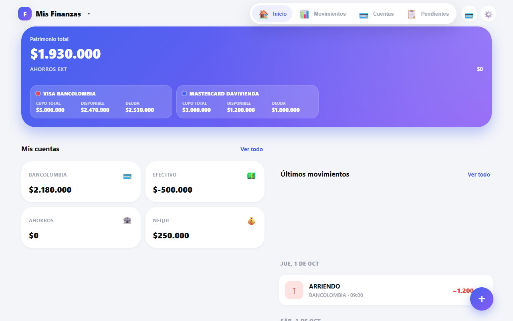
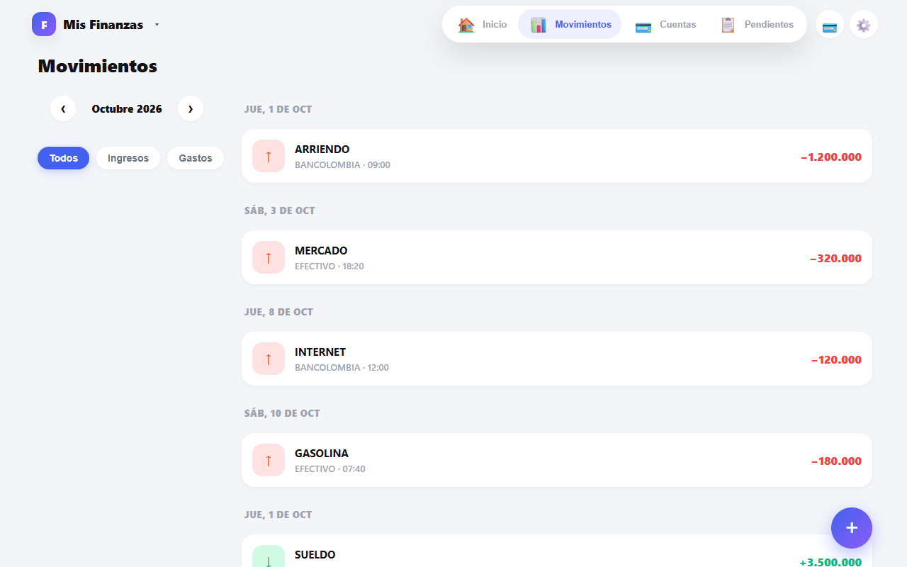
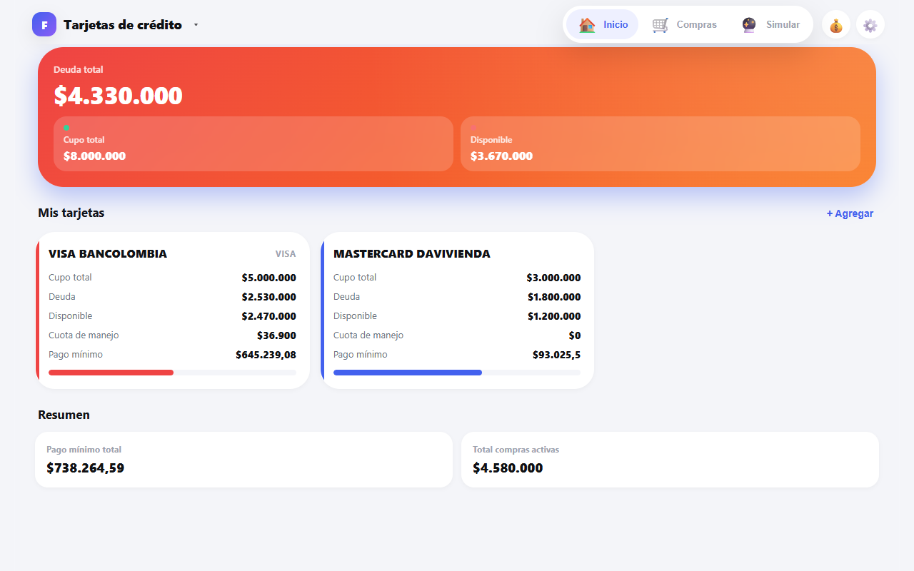
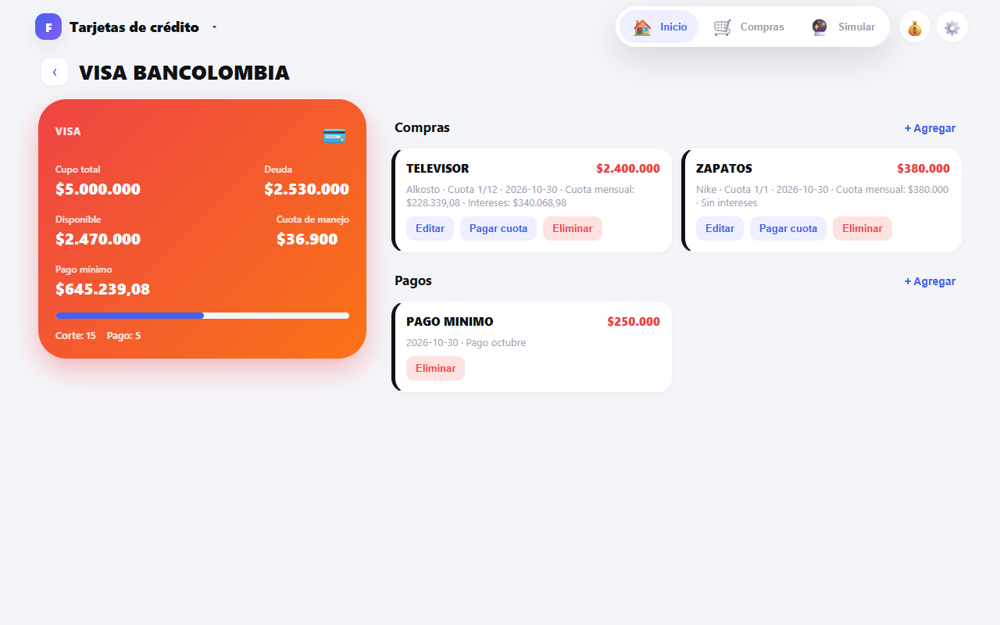

# 💰 FinanzasApp

Self-hosted personal finance web app: accounts, income/expenses, transfers, monthly
pending payments and a credit-card module. Built with Node.js, Express, SQLite and
vanilla JS. Installable on the home screen of iOS and Android.


<p align="center">
  
</p>

## ✨ Features

| Feature | Description |
|---|---|
| 💳 Multi-account | Manage accounts (bank, cash, savings, …) |
| ➕ Income & expenses | Log entries with date, description, amount and account |
| ✏️ Edit & delete | Modify or remove any transaction in place |
| ⇄ Transfers | Move funds between accounts in one step |
| 👥 Account groups | Group accounts and see their combined total |
| 📋 Pending payments | Monthly bills grouped by category, with partial payments |
| 📊 Available balance | Real-time total excluding accounts you hide |
| 💳 Credit cards | Cards, installments, interest, minimum payment and simulator |
| 🌙 Dark mode | Full dark theme, persisted in `localStorage` |
| 📱 Home screen | "Add to Home Screen" on iPhone and Android |

## 📸 Screenshots

<p align="center">
  
  
</p>
<p align="center">
  
</p>

## 🛠 Tech stack

- **Backend**: Node.js + Express
- **Database**: SQLite via `better-sqlite3`
- **Frontend**: vanilla JS, HTML5, CSS3 with CSS variables (no frameworks)
- **Deploy**: Docker + Docker Compose

## 🚀 Quick start

```bash
git clone https://github.com/JUANRESTREPO95/finanzas-app.git
cd finanzas-app
docker compose up -d --build
```

App available at **http://localhost:3002** (the container listens on 3000).

### Development without Docker

```bash
cd backend
npm ci
node server.js          # http://localhost:3000
```

Requires Node 20 or newer. The database files are created automatically under
`backend/data/`.

## 📁 Project structure

```
finanzas-app/
├── docker-compose.yml
├── .dockerignore
├── .editorconfig
├── LICENSE
├── SECURITY.md
├── .github/
│   └── workflows/ci.yml        # syntax check on every push
├── docs/
│   └── screenshots/
├── data/                       # SQLite volumes (created at runtime)
├── backend/
│   ├── Dockerfile              # multi-stage build (compiles better-sqlite3)
│   ├── package.json
│   ├── server.js               # Express API: accounts, movements, pending
│   ├── database.js             # finances DB + migrations
│   ├── tarjetas-routes.js      # credit-card API
│   └── tarjetas-database.js    # cards DB + migrations
└── frontend/
    ├── index.html              # single-page app (both modules)
    ├── app.js                  # UI logic
    ├── styles.css              # variables, dark mode, responsive layout
    └── icon.png
```

## 🐳 Docker

```bash
docker compose up -d --build    # start
docker compose logs -f          # logs
docker compose down             # stop
```

The image is built in two stages: dependencies (including the native
`better-sqlite3` module) are compiled with the build toolchain, and the final
image only carries the runtime.

## 💾 Data

Everything lives in `./data/`, mounted as a bind volume:

- `data/finanzas.db` — accounts, movements, pending payments, groups
- `data/tarjetas.db` — cards, purchases, payments, simulations

Back up by copying that folder.

## 🗄 Database schema

```sql
-- Finances
cuentas        (id, nombre, incluir_en_total)
grupos_cuentas (id, nombre, cuentas)          -- cuentas = JSON array
ingresos       (id, fecha_hora, descripcion, monto, cuenta, created_at)
salidas        (id, fecha_hora, descripcion, monto, cuenta, created_at)
pendientes     (id, fecha, descripcion, monto_mensual, abono, restante, pagado, categoria)

-- Credit cards
tarjetas      (id, nombre, franquicia, cupo_total, deuda_actual, tasa_mensual,
               tasa_anual, dia_corte, dia_pago, cuota_manejo, color)
compras       (id, tarjeta_id, nombre, monto, cuotas, cuota_actual, cuota_mensual,
               total_intereses, sin_interes, fecha, estado)
pagos         (id, tarjeta_id, monto, tipo, fecha, nota)
simulaciones  (id, nombre, tarjeta_id, monto, cuotas, cuota_mensual, total_pagado,
               total_intereses, estado)
```

`fecha_hora` is stored as local time in `YYYY-MM-DD HH:MM`. The timezone used
for server-generated timestamps is `America/Bogota` by default; override it with
the `APP_TIMEZONE` environment variable.

## 🔌 API reference

### Accounts
| Method | Endpoint | Description |
|---|---|---|
| `GET` | `/api/cuentas` | List accounts |
| `POST` | `/api/cuentas` | Create account |
| `DELETE` | `/api/cuentas/:nombre` | Delete account |
| `PUT` | `/api/cuentas/:nombre/visible` | Include/exclude from total |

### Movements
| Method | Endpoint | Description |
|---|---|---|
| `GET` | `/api/movimientos?mes=&anio=` | Movements (optionally by month) |
| `POST` | `/api/ingresos` | Add income |
| `POST` | `/api/salidas` | Add expense |
| `POST` | `/api/transferencia` | Transfer between accounts |
| `PUT` | `/api/movimientos/:tipo/:id` | Edit movement (`tipo` = INGRESO / SALIDA) |
| `DELETE` | `/api/ingresos/:id` | Delete income |
| `DELETE` | `/api/salidas/:id` | Delete expense |

### Balances
| Method | Endpoint | Description |
|---|---|---|
| `GET` | `/api/totales` | Balance per account, groups and net worth |
| `GET` | `/api/totales/sin-ahorros` | Total of visible accounts |
| `GET` | `/api/resumen/mes-actual` | Income and expenses of the current month |

### Account groups
| Method | Endpoint | Description |
|---|---|---|
| `GET` | `/api/grupos` | List groups |
| `POST` | `/api/grupos` | Create group |
| `PUT` | `/api/grupos/:id` | Update group |
| `DELETE` | `/api/grupos/:id` | Delete group |

### Pending payments
| Method | Endpoint | Description |
|---|---|---|
| `GET` | `/api/pendientes` | Unpaid items |
| `GET` | `/api/pendientes/all` | All items (paid + unpaid) |
| `GET` | `/api/pendientes/cats` | Existing categories |
| `POST` | `/api/pendientes/nuevo` | Add item |
| `PUT` | `/api/pendientes/:id` | Edit item |
| `PUT` | `/api/pendientes/abono` | Record partial payments (batch) |
| `DELETE` | `/api/pendientes/:id` | Delete item |
| `DELETE` | `/api/pendientes/categoria/:nombre` | Delete a whole category |
| `POST` | `/api/pendientes/reiniciar` | Reset all monthly payments |

### Credit cards (`/api/tarjetas`)
| Method | Endpoint | Description |
|---|---|---|
| `GET` | `/api/tarjetas` | List cards |
| `POST` | `/api/tarjetas` | Create card |
| `PUT` | `/api/tarjetas/:id` | Update card |
| `DELETE` | `/api/tarjetas/:id` | Delete card (cascades to purchases/payments/simulations) |
| `GET` | `/api/tarjetas/resumen` | Totals: credit, debt, available, minimum payment |
| `GET` | `/api/tarjetas/compras/:tarjeta_id` | Purchases of a card |
| `POST` | `/api/tarjetas/compras` | Add purchase |
| `POST` | `/api/tarjetas/compras/:id/avanzar` | Advance one installment |
| `DELETE` | `/api/tarjetas/compras/:id` | Delete purchase |
| `GET` | `/api/tarjetas/pagos/:tarjeta_id` | Payments of a card |
| `POST` | `/api/tarjetas/pagos` | Register payment |
| `POST` | `/api/tarjetas/simular` | Simulate installments (no save) |
| `GET` | `/api/tarjetas/simulaciones` | Saved simulations |
| `POST` | `/api/tarjetas/simulaciones` | Save simulation |
| `POST` | `/api/tarjetas/simulaciones/:id/finalizar` | Turn simulation into a purchase |
| `DELETE` | `/api/tarjetas/simulaciones/:id` | Delete simulation |

## 📱 Install on a phone

- **iPhone**: open in Safari → Share → "Add to Home Screen"
- **Android**: open in Chrome → menu → "Add to Home Screen"

## 🔒 Security

This app has **no authentication** and enables CORS for all origins. Run it on
your local network or behind a reverse proxy with authentication. Do not expose
it directly to the internet as is.

## 📄 License

[MIT](LICENSE) © Juan Pablo Restrepo Acosta
